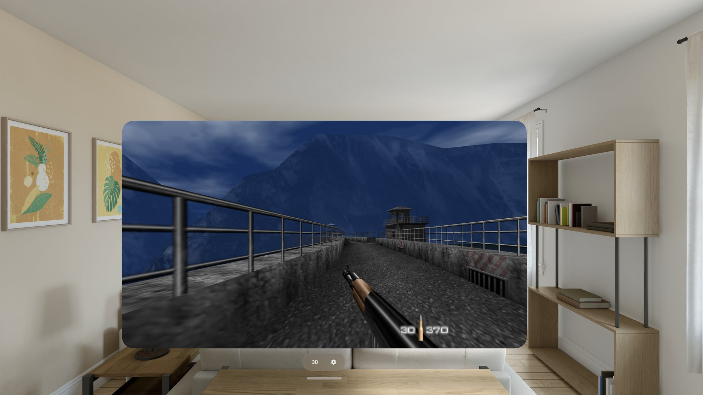

# Project Midas for iPhone, iPad & Apple Vision Pro

A native iOS and visionOS port of
[Project Midas](https://github.com/murkantor/Project-Midas) by murkantor (MIT),
the PC port of GoldenEye 007 built from the
[n64decomp GoldenEye decompilation](https://github.com/n64decomp/007). It is not
an emulator: the decompiled game code is compiled for Apple silicon (arm64) and
renders through Project Midas's Fast3D renderer on Metal, via ANGLE.

Project Midas's own feature set comes along: its options, profiles, weapon sets
and multiplayer setup are the upstream code, wrapped by an iOS/visionOS shell
rather than replaced.

Requires **iOS 15 or later**, or **Apple Vision Pro on visionOS 26 or later**.



---

## Install

**Add the SideStore source**. This is the easiest path, and the app updates
when new versions ship:

| Device | Source | Source URL |
| --- | --- | --- |
| iPhone / iPad | All ports | `https://raw.githubusercontent.com/rebelancap/all-ports/main/apps-ios.json` |
| Apple Vision Pro | All ports | `https://raw.githubusercontent.com/rebelancap/all-ports/main/apps-visionos.json` |

In [SideStore](https://sidestore.io) / [AltStore](https://altstore.io):
*Sources → **+** → paste the URL*, then install Project Midas. This is a shared
source; it carries the other rebelancap ports too.

On **Apple Vision Pro**, first install SideStore onto the headset with
[iloader](https://github.com/rebelancap/iloader/releases#release-visionos)
(SideStore/AltStore can't be installed on visionOS the usual way; iloader is
what gets SideStore there). Then add the source in SideStore exactly as above.

SideStore keeps the source it already fetched until you **pull to refresh** on
the source. Its **Refresh** button re-signs the app you already have installed;
it is not an update. Pull to refresh on the source to see a new version.

**Prefer a manual install?** Download `projectmidas-<VERSION>-iOS.ipa` or
`projectmidas-<VERSION>-visionOS.ipa` from the
[latest release](https://github.com/rebelancap/Project-Midas-ios/releases/latest)
and install it through SideStore / AltStore yourself (iPhone and iPad can also
use [Sideloadly](https://sideloadly.io)).

## You bring the game

**The app ships with no game data.** No ROM, no textures, no audio and no Xbox
360 content is in this repository or in the IPA. Dumping your own cartridge is
on you; please don't ask where to find it, and don't post links in the issue
tracker.

### The ROM (required)

You need the **GoldenEye 007 (USA) / NTSC-U** cartridge image:

| | |
| --- | --- |
| sha1 | `abe01e4aeb033b6c0836819f549c791b26cfde83` |
| size | 12 MB (a 96 Mbit cartridge) |

On first launch the app shows a setup screen. Supply the ROM in any of these
ways:

- Tap **Choose ROM…** and pick the file from iCloud Drive, a USB drive or
  anywhere else in Files. The app copies it into its own folder; your original
  is not touched.
- Or **AirDrop** it to the iPhone or headset, or share it from Files (long-press
  → Share), and pick **Project Midas**: it is checked and copied in the same way.
- Or copy it into **Files → On My iPhone → Project Midas** (on the headset:
  **On My Apple Vision Pro → Project Midas**). The setup screen re-checks by
  itself, including while a large copy is still arriving.

Any filename works, and `.z64`, `.n64` and `.v64` dumps are all accepted (a
byte-swapped dump is converted to a separate copy once; your file is left as
it is). The setup screen says in words what is wrong with a file it rejects:
too short, not an N64 ROM, a compressed archive that needs unpacking first, a
different game or a ROM hack, or the European or Japanese cartridge, which
this release does not run.

### Texture packs and the XBLA graphics (optional)

Both are found in the gear menu under **Settings → Textures**.

- **GoldenEye XBLA graphics.** If you own the unreleased Xbox 360 GoldenEye
  remaster, tap **Import GoldenEye XBLA…** and pick your copy: the `.7z` you
  keep it in, the Xbox 360 package itself (the file under
  `584108A9/000D0000/`), or the unpacked folder. The app copies it into
  **Files → Project Midas → xbla** and decodes it once, with progress shown in
  the row. **GoldenEye XBLA graphics** then switches the remaster's art on or
  off, including its own fonts and HUD icons. **Remove imported XBLA** deletes
  the decoded textures and the app's copy (it asks first; your original is not
  touched).
- **Texture packs.** Packs live in **Files → Project Midas → texturepacks**,
  one folder each, and are chosen under **Texture pack**. Without an XBLA copy,
  the community **GoldenEye 007 HD** pack (by intermissionfb and GhostlyDark)
  works as it is: download the repository zip from
  <https://github.com/GhostlyDark/GoldenEye-007-HD> (about 2.4 GB, no
  releases), move it into `texturepacks`, tap it in Files to unzip it, then
  pick the folder. A pack that is still zipped is not listed. GLideN64/Rice
  style packs (`GOLDENEYE#<checksum>#...png`) and numbered packs are both read.

With both on, a level the remaster redrew uses the remaster's art and the pack
covers everything else; turn XBLA off to see the pack everywhere. Changes apply
immediately.

Your saves, settings and profiles live in the same app folder, visible in the
Files app, separate from the game data.

## Controls

- **Game controllers**: any MFi / Xbox / PlayStation controller, with
  Project Midas's own layout: right trigger fire, left trigger aim, A use,
  B next gadget, X reload, Y next weapon, left-stick click crouch. While
  aiming, the left stick zooms the sniper rifle and camera (up / down) and
  leans (left / right). Project Midas's local split-screen multiplayer works
  with **one controller per player**.
- **Touch controls** appear automatically when no controller is connected
  (Auto / On / Off): a move stick on the left, drag on the right to look, and
  buttons for FIRE, AIM, USE, RELOAD, WEAPON, CROUCH (tap to crouch, tap
  again to stand) and GADGET (cycles your gadgets; hold it and tap FIRE to
  go back). While AIM is held, the stick zooms (up / down) and leans
  (left / right) instead of walking. Button opacity, haptics, stick dead zone
  and curve are adjustable, and **Customize layout…** moves and resizes the
  buttons.

## Settings

Tap the **gear** in the top-left corner. The sheet has:

- **Touch controls** and **Controller**: the options above.
- **Video**: Max FPS (up to 120 on a ProMotion screen; it also sets the game's
  tick rate, as on the PC), an FPS readout, antialiasing, render resolution
  (N64 to native), texture filtering, anisotropy, 2D upscale for the HUD and
  text, field of view, widescreen (stretch / wide / 4:3) and **Classic Mode**,
  the N64 look.
- **Textures**: texture pack and the XBLA import, as above.
- **Game**: crosshair, auto-aim, ammo on screen, aim lock, steady scope,
  stamina sway, mission timer, unlock all.
- **Audio**: music and sound volume, and what happens to other apps' audio
  while you play.
- **Diagnostics**: frame rate, thermal state, version, crash log.

Project Midas's own options file (`midas.ini`, documented by
`midas_ini_help.txt`) is in the app folder too.

## Apple Vision Pro

The 2D window runs the whole game in a resizable window, paced to the
headset's display rate. Open **3D mode** and the game moves onto a
world-locked stereoscopic panel in your room, both eyes rendered every frame.
The **3D Settings** sheet is live while you play: screen distance, width,
height and position height, stereo depth, surroundings dimming, render
resolution, an FPS readout on the panel, metres or feet, and **Recenter
Screen**. A paired controller is strongly recommended in the headset.

## Building from source

Requires macOS with Xcode (iOS and visionOS SDKs), plus `cmake`, `ninja` and
`xcodegen` (`brew install cmake ninja xcodegen`). **No game data is needed to
build.** The upstream Docker build is for the 32-bit PC targets and is not
used here.

```sh
scripts/bootstrap-deps.sh          # link prebuilt ANGLE (Metal) slices and static
                                   # SDL2 into work/ (the script names the sources;
                                   # scripts/build-sdl2-visionos.sh builds SDL2 for xrOS)
scripts/build-ios.sh simulator     # engine -> build-ios-sim/libmidas.a, then the app
scripts/build-ios.sh device        # engine -> build-ios-device/libmidas.a, signed app
scripts/build-ios.sh xrsimulator   # visionOS simulator
scripts/build-ios.sh visionos      # visionOS device
```

`scripts/build-ios.sh <kind> --engine` builds only the engine library.
The app half runs `scripts/gen-app-project.sh`, which writes the marketing
version from `app/VERSION` and `app/DEV_ITERATION` into the xcodegen spec
(`app/project.yml`) and generates `app/ProjectMidas.xcodeproj`, with an iOS
scheme (`ProjectMidas`) and a visionOS scheme (`ProjectMidas-visionos`).
Products land in `build/Build/Products/Release-<sdk>/ProjectMidas.app`. Device
builds sign with your own team: `GE_TEAM_ID=<your team id> scripts/build-ios.sh device`
(see the comment in `scripts/build-ios.sh` for an optional App Store Connect key).

Upstream Project Midas assumes a 32-bit build (a guest address is a host
pointer). The arm64 work lives in `port/apple/`, `app/`, `scripts/` and
`#ifdef`-guarded edits elsewhere, so upstream changes fold in cleanly.

## Credits

- **[Project Midas](https://github.com/murkantor/Project-Midas)** by
  **murkantor** and contributors: the PC port this is built on, its renderer
  work, options, profiles, weapon sets, multiplayer and the XBLA and texture
  pack support. Its own acknowledgements, all of which apply here:
  - [GoldenEye decompilation](https://github.com/n64decomp/007) by KholdFuzion
    and contributors, and the [GoldenEye docs](https://github.com/kholdfuzion/goldeneye_docs)
  - [Perfect Dark decompilation](https://github.com/n64decomp/perfect_dark) by
    Ryan Dwyer and contributors
  - [Perfect Dark PC port](https://github.com/fgsfdsfgs/perfect_dark) by fgsfds
    and contributors
  - [Perfect Dark netplay](https://github.com/murkantor/perfect_dark_netplay)
    by murkantor
  - [GE Plus](https://github.com/Joshua-1248/GoldenEye-007-Plus) by Joshua
  - [ENet](https://github.com/lsalzman/enet) by Lee Salzman,
    [xdelta3](https://github.com/jmacd/xdelta) by Josh MacDonald,
    [qemu-irix](https://github.com/n64decomp/qemu-irix),
    [pj64raphnetraw](https://github.com/raphnet/pj64raphnetraw) by Raphael
    Assenat, the 1964 emulator and its mouse injector, and J.M.P. van
    Waveren's *The DOOM III Network Architecture*
  - Bundled third-party code (Fast3D by Emill and MaikelChan, glad,
    SDL_GameControllerDB and others) keeps its own licence; see
    `tools/THIRD_PARTY_NOTICES.txt`.
- **[SDL2](https://libsdl.org)**: windowing, input and audio.
- **[ANGLE](https://chromium.googlesource.com/angle/angle)**: OpenGL ES on
  Metal, which is how the renderer reaches the GPU here.
- **[Perfect Dark for iPhone & Apple Vision Pro](https://github.com/rebelancap/perfect-dark-ios)**,
  built on the fgsfds Perfect Dark PC port: the visionOS stereo 3D recipe and
  the XBLA font method used here.
- **GoldenEye-Decomp-ios**, the sibling port of the same decompilation: the
  arm64 pointer contract and the iOS shell this port started from.
- **GoldenEye 007 HD** texture pack by intermissionfb and GhostlyDark
  (not bundled; you download it yourself).
- GoldenEye 007 is owned by Rare, Nintendo and the Bond rights holders; the
  XBLA remaster's art is Rare's and is supplied by you, never by this project.
  This project is not affiliated with, endorsed by, or connected to any of them.

## Licence

Released under the **MIT Licence** (see [`LICENSE`](../LICENSE)), matching
upstream Project Midas. It covers the porting code only; it does not cover the
decompiled game code, GoldenEye itself or its assets.
